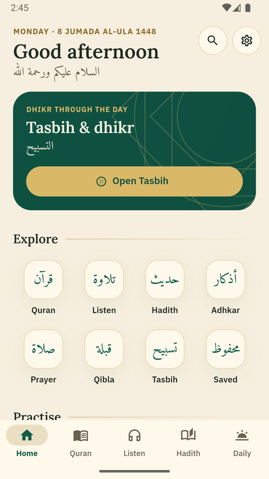
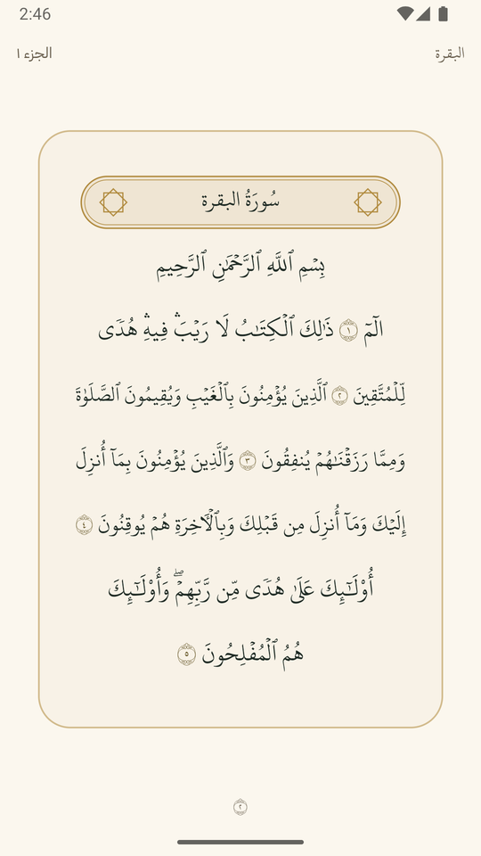
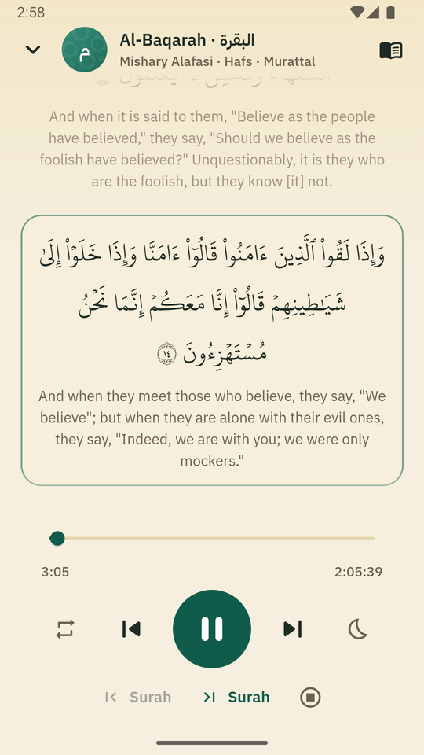
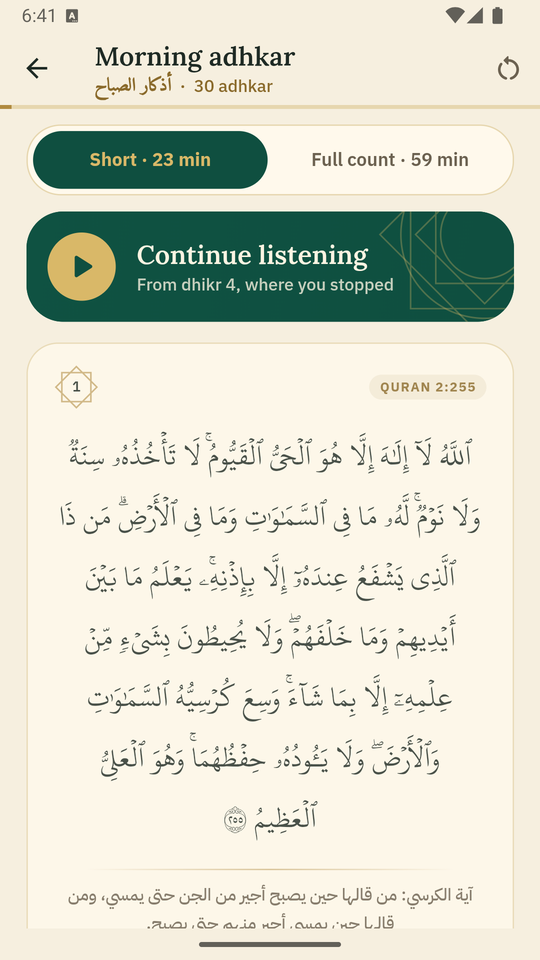
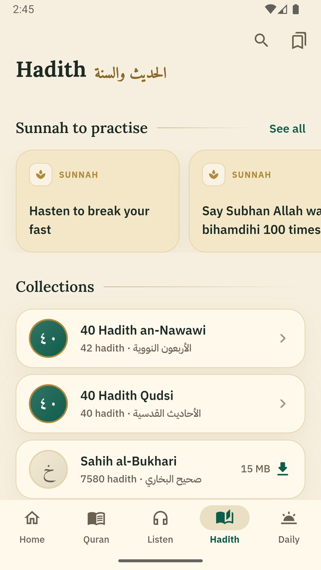
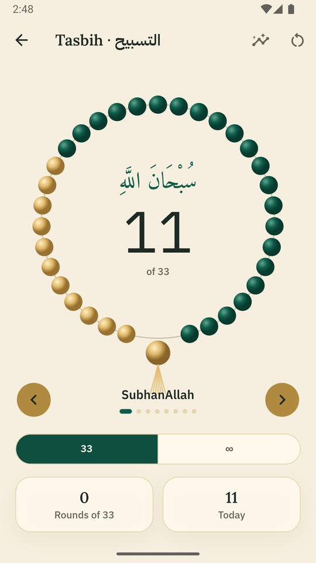

<p align="center">
  
</p>

<h1 align="center">Siraj · سراج</h1>

<p align="center">
  <b>A free, open-source Muslim companion: Quran, 100+ reciters, hadith, adhkar and prayer times.</b><br>
  No ads. No account. No tracking. Works offline.
</p>

<p align="center">
  
  
</p>

## Install

Download **Siraj.apk** from the [latest release](https://github.com/Abuubakar-Ciise/Siraj/releases/latest), open it
on your Android phone and tap Install.

## Screenshots

| Home | Mushaf | Follow the recitation |
|:---:|:---:|:---:|
|  |  |  |
| **Listen to adhkar** | **Hadith & Sunnah** | **Tasbih** |
|  |  |  |

## Features

- **Mushaf:** the complete Madani Mushaf, 604 pages, fully offline, with search.
- **Listen:** 103 reciters, ayah-by-ayah follow-along, downloads, repeat and sleep timer.
- **Hadith & Sunnah:** Bukhari, Muslim, the Sunan, Muwatta, 40 Nawawi and 40 Qudsi, with grades.
- **Adhkar:** Hisn al-Muslim with a human recording for every dhikr; listen Short or Full count.
- **Prayer times & Qibla**, **Tasbih**, a **memorization test** and **daily reminders**.
- **Private:** no account, no ads, no analytics.

## Build

```bash
flutter pub get
flutter run
flutter build apk --release
```

## Sources & licenses

Quran text and font: KFGQPC. Recitations: [mp3quran.net](https://mp3quran.net). Hadith:
[fawazahmed0/hadith-api](https://github.com/fawazahmed0/hadith-api). Adhkar: Hisn al-Muslim; recordings by Mishary
Alafasy, [hisnmuslim.com](https://www.hisnmuslim.com) and others on archive.org. Fonts: IBM Plex Sans Arabic, Amiri
and Lora (SIL OFL).

The app code is released under the [MIT License](LICENSE). Bundled content keeps its own terms.
